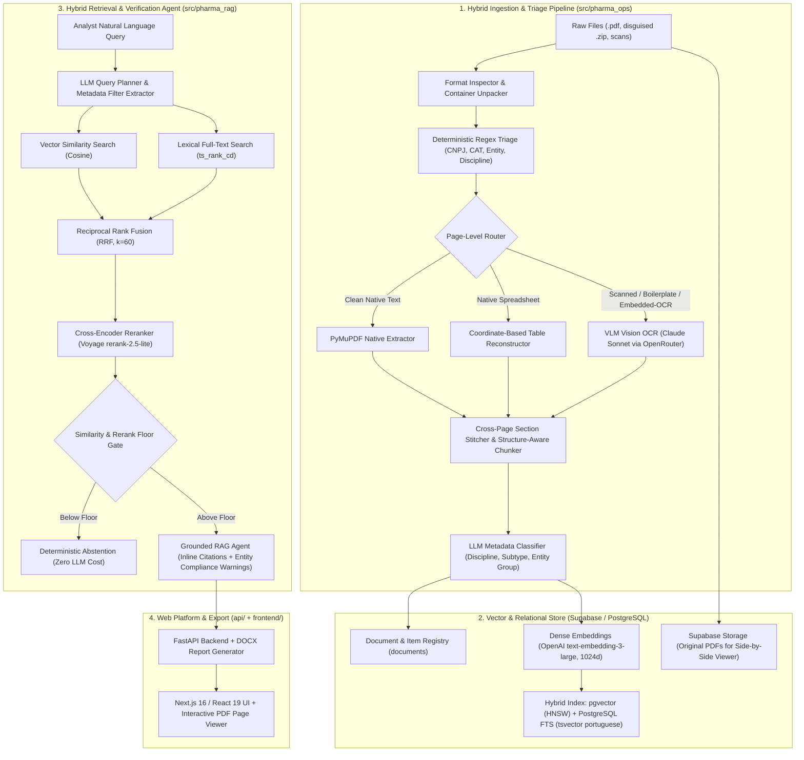

# Pharma Operations Platform — Enterprise Vendor Hub & Technical Tender RAG Engine

An end-to-end **Document Intelligence & Retrieval-Augmented Generation (RAG) Platform** engineered to ingest, structure, audit, and query complex pharmaceutical and industrial engineering records—specifically Technical Capacity Certificates (*Atestados de Capacidade Técnica*), Council Registration Certificates (*CATs / CREA / CAU*), and multi-hundred-page engineering bills of quantities (*planilhas orçamentárias*).

---

## 1. The Engineering Problem

In regulated pharmaceutical and industrial engineering tenders (cleanrooms ISO 5–8, HVAC/chiller plants, WFI/PW purified water loops, pure steam generators, and BSL biosafety laboratories), qualification depends on proving past technical execution through historical **CATs and Technical Capacity Certificates**.

Standard off-the-shelf RAG pipelines fail catastrophically on this domain due to five compounding engineering challenges:

1. **Heterogeneous & Degraded Document Scans**: Historical certificates span decades of scans with skewed tables, multi-column stamps, council watermarks (CREA/CAU), and disguised file containers (e.g., `.pdf` files that are actually `.zip` archives of JPEG scans, or PDFs with corrupted legacy embedded OCR layers).
2. **Dense Quantitative Spreadsheets Across Page Boundaries**: A single certificate often contains 30–140 pages of engineering spreadsheets where hierarchical section headers (`4. INSTALAÇÕES ELÉTRICAS` $\rightarrow$ `4.2 LUMINOTECNIA`) appear on page 40 while line items (`Luminária sala limpa embutir LED 46W — 121 UN`) appear on page 43. Naive fixed-size chunking severs items from their parent discipline and unit of measure.
3. **Lexical vs. Semantic Mismatch**: Procurement analysts query exact technical codes, council registry numbers (`CAT 100200`), standards (`ISO 7`, `RDC 658`), or equipment capacities (`1.320 TR`, `820 kg/h`), where pure dense embeddings underperform, alongside conceptual queries (*"cleanroom airlock interlocks"*), where pure BM25 fails.
4. **Corporate Entity Attribution (Principal vs. Affiliated Portfolio)**: Engineering groups frequently hold certificates under both a primary bidding entity (**Pharma Operations Platform**) and affiliated engineering entities (**Enterprise Vendor Hub**) or consortia. Treating affiliated certificates as direct company capacity without explicit qualification creates severe compliance risk in public and private tenders.
5. **Zero-Tolerance for Hallucination & Untraceable Claims**: Every quantitative answer used in a tender qualification dossier must cite the exact document, page range, and verbatim source excerpt, and must deterministically abstain when evidence is absent or below confidence thresholds.

---

## 2. System Architecture

The platform follows the **WAT Architecture (Workflows, Agents, Tools)**—strictly decoupling probabilistic LLM/VLM reasoning from deterministic Python execution and validation pipelines.



### Key Architectural Subsystems

#### 2.1. Page-Level Hybrid OCR & Format Inspection (`src/pharma_ops/extracao.py`, `formatos.py`)
- **Magic-Byte Inspection**: Detects misnamed archives (`.pdf` files containing `PK\x03\x04` ZIP headers or raw images) before PDF parsing.
- **5-Signal Page Router**: Evaluates each page independently using character count, text-to-area density, council watermark/boilerplate ratio (CREA/CAU headers/footers), unit-of-measure density (`m²`, `m³`, `TR`, `kVA`, `kg/h`), and embedded-OCR heuristics (detecting full-page image scans with noisy legacy OCR layers).
- **Spreadsheet Reconstruction & Truncation Recovery**: Reconstructs native multi-column engineering tables by clustering word bounding-box coordinates (`x0, y0, x1, y1`) and automatically detects/retries truncated VLM markdown outputs (`finish_reason == "length"` or unclosed markdown tables).
- **Content-Addressed OCR Cache**: Caches paid VLM responses in `.cache_ocr/` keyed by SHA-256 content hashes to guarantee idempotent, zero-waste re-runs.

#### 2.2. Cross-Page Section Stitching & Semantic Chunking (`src/pharma_ops/chunking.py`)
- **Hierarchical Header Propagation**: Tracks numbered engineering sections (`1.2.3`) and breadcrumb trails (`REVESTIMENTOS > PISO`) across page breaks so every table slice retains its full context header.
- **Cover-Page Synthesis**: Extracts scattered key-value fields from multi-column council certificates (Contractor, Contracting Authority, CNPJ, Contract Value, Execution Period, Technical Lead) into a cohesive summary chunk for high-precision metadata queries.

#### 2.3. Hybrid Search + Reciprocal Rank Fusion + Cross-Encoder Reranking (`src/pharma_rag/retrieval/`)
- **Dual Retrieval**: Executes parallel vector cosine similarity (`pgvector`) and Portuguese full-text search (`plainto_tsquery('portuguese', ...)` / `websearch_to_tsquery`) pushed down into PostgreSQL with metadata pre-filtering (`orgao`, `disciplinas`, `executante_grupo`, `tipo_documento`).
- **RRF & Reranking**: Merges candidate lists via Reciprocal Rank Fusion ($k = 60$) and re-scores top candidates using **Voyage `rerank-2.5-lite`**, enforcing calibrated minimum similarity and rerank floors to eliminate false-positive noise.

#### 2.4. Citation-Grounded Agent & Entity Governance (`src/pharma_rag/agent/`)
- **Strict Inline Citations**: Forces every factual claim to carry a structured `[doc:N p.X]` citation mapped back to verified `ChunkComScore` objects, stripping any hallucinated indices post-generation.
- **Affiliated Portfolio Guardrails**: Automatically distinguishes between certificates executed directly by **Pharma Operations Platform** (`executante_grupo = "principal"`) and those belonging to **Enterprise Vendor Hub** (`executante_grupo = "coligada"`), injecting mandatory compliance badges when affiliated records are cited.

---

## 3. Technology Stack

| Layer | Technologies |
| :--- | :--- |
| **Language & Runtime** | Python 3.11+ (`uv`), TypeScript 5, Node.js 20+ |
| **Document Processing & OCR** | PyMuPDF (`fitz`), Pillow, Vision LLMs via OpenRouter (`anthropic/claude-sonnet-5`) |
| **Database & Vector Store** | PostgreSQL 15+ (Supabase), `pgvector` (1024-d vectors), PostgreSQL Full-Text Search (`tsvector`), Supabase Storage |
| **RAG, Embeddings & Reranking** | LangChain Core (`BaseRetriever`), OpenAI `text-embedding-3-large` (1024 dims), Voyage AI (`rerank-2.5-lite`), Anthropic SDK / OpenRouter |
| **Backend API & Reporting** | FastAPI, Pydantic v2, `psycopg` v3 (binary), `python-docx` (automated corporate `.docx` dossier export) |
| **Frontend Application** | Next.js 16 (App Router), React 19, Tailwind CSS v4, Radix UI / shadcn, `react-pdf` (side-by-side source page viewer), Playwright |
| **Quality & Evaluation** | Pytest (offline test suite with deterministic fakes), Ruff, Golden Set Recall@K & MRR evaluator (`tools/avaliar.py`) |

---

## 4. Repository Structure

```text
├── api/                        # FastAPI backend, ingestion endpoints, mock mode, and DOCX exporter
├── data/
│   └── golden_set.json         # Synthetic Golden Set benchmark for retrieval evaluation (Recall@5 / MRR)
├── docs/                       # Architecture documentation, ADRs (DECISOES.md), and engineering logs
├── frontend/                   # Next.js 16 web interface (Query chat, Collection explorer, Upload, PDF viewer)
├── src/
│   ├── pharma_ops/             # Layer 1: Format inspection, regex triage, hybrid OCR, chunking, classification
│   └── pharma_rag/             # Layer 2: Database repository, embeddings, hybrid search + RRF, reranker, RAG agent
├── tests/                      # Comprehensive offline unit & integration test suite (Pytest)
├── tools/                      # Deterministic CLI tools (extraction, chunking, indexing, evaluation, diagnostics)
├── workflows/                  # Markdown SOPs defining operational procedures (WAT architecture)
├── .env.example                # Template of all environment variables
└── pyproject.toml              # Python dependencies, build config, and CLI entry points
```

---

## 5. Getting Started

### 5.1. Prerequisites
- **Python 3.11+** (recommended with [`uv`](https://github.com/astral-sh/uv))
- **Node.js 20+** and `npm`
- Optional for live mode: **Supabase** project (PostgreSQL + `pgvector`) and API keys (`OPENROUTER_API_KEY`, `OPENAI_API_KEY`, `VOYAGE_API_KEY`).
  *(Note: Both the test suite and the full web application can run 100% offline using `MODO_DEMO=1`.)*

### 5.2. Backend Setup & Offline Verification

```bash
# 1. Install dependencies (including dev tools)
uv sync --extra dev

# 2. Configure environment variables
cp .env.example .env

# 3. Run the offline test suite and linter (no API keys or database required)
uv run pytest -v
uv run ruff check src/ tests/ tools/ api/
```

### 5.3. Running the Full Stack (API + Next.js Frontend)

**Start the FastAPI Backend** (use `MODO_DEMO=1` to run with synthetic mock data without external APIs):
```bash
MODO_DEMO=1 uv run uvicorn api.main:app --reload --port 8000
```

**Start the Next.js Frontend**:
```bash
cd frontend
npm install
npm run dev
```
Access the web platform at `http://localhost:3000`.

### 5.4. CLI Pipeline Commands (Live Ingestion & Evaluation)

```bash
# 1. Triage raw documents (zero API cost — regex & format inspection)
uv run python tools/triar_documentos.py

# 2. Extract text via Hybrid Router (PyMuPDF native + VLM OCR with local cache)
uv run pharma-extrair

# 3. Run structure-aware chunking with cross-page table stitching
uv run pharma-chunks

# 4. Validate database schema and run Hybrid Search + RRF smoke test
uv run python tools/setup_supabase.py --check --smoke

# 5. Index chunks, classify metadata, and generate vector embeddings
uv run python tools/indexar.py
uv run python tools/classificar_documentos.py
uv run python tools/generate_embeddings.py

# 6. Evaluate retrieval Recall@5, MRR, and calibrate similarity threshold against the Golden Set
uv run python tools/avaliar.py --calibrar
```
