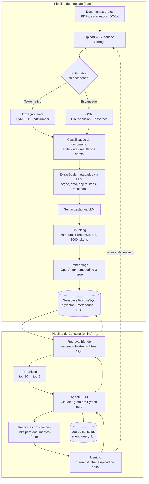

# Arquitetura — Assistente de IA para Validação de Licitações (Solufarma, Módulo 2)

> **Documento técnico de referência** — ITA Júnior / Solufarma
> Autor: AI Engineer (persona sênior RAG/LLM/MLOps) · Data: 2026-08-04 · Versão: 0.1 (rascunho para validação da equipe)
>
> Escopo: assistente de IA que interpreta solicitações sobre licitações farmacêuticas/engenharia clínica, busca projetos e equipamentos semelhantes no acervo histórico (editais, atas, resultados) e analisa novos editais contra o histórico validado, com rastreabilidade total das fontes.

---

## 1. Visão geral da arquitetura

O sistema tem dois fluxos principais: **ingestão** (offline/batch, alimenta o acervo) e **consulta** (online, pipeline RAG + agente). Ambos compartilham o Supabase (PostgreSQL + pgvector + Storage) como fonte única de verdade.



Pontos-chave do desenho:

- **Separação ingestão × consulta**: a ingestão é determinística e re-executável (scripts em `tools/`, conforme o framework WAT do projeto); a consulta é orquestrada pelo agente.
- **Supabase como hub**: Storage guarda os PDFs originais (rastreabilidade), PostgreSQL guarda metadados estruturados, chunks e vetores (pgvector). Um único banco simplifica joins entre busca semântica e filtros estruturados.
- **Novo edital enviado pela interface** passa pelo mesmo pipeline de ingestão (em modo síncrono/rápido) antes da análise comparativa.

---

## 2. Decisões de stack recomendadas

### 2.1 OCR / extração de texto

| Opção | Prós | Contras | Custo |
|---|---|---|---|
| **PyMuPDF/pdfplumber (PDF nativo)** — *sempre a 1ª tentativa* | Grátis, rápido, determinístico | Só funciona em PDF com camada de texto | R$ 0 |
| **Claude com visão (PDF/imagem direto na API)** — **recomendado p/ escaneados** | Excelente em documentos degradados, tabelas e carimbos; já extrai estrutura junto; sem infra extra | Custo por página; limite de 600 págs/requisição (dividir editais longos) | ~US$ 3–15 por 1.000 páginas (depende do modelo) |
| Tesseract (+ OCRmyPDF) | Grátis, local, bom p/ volume alto de docs limpos | Qualidade fraca em escaneados antigos/tortos, tabelas quebram; exige pré-processamento (deskew, binarização) | R$ 0 (só compute) |
| Google Document AI / Azure Document Intelligence | Melhor OCR "puro" do mercado, layout parsing nativo | Mais um fornecedor/billing/credencial; setup GCP; ~US$ 1,50/1.000 págs (Doc AI OCR) | Baixo-médio |

**Recomendação prática (12 semanas, equipe de 4):** pipeline em cascata —
1. Tentar extração nativa (PyMuPDF). Se a densidade de texto for boa, encerrar.
2. Caso contrário, enviar o PDF/página como documento para a **API Claude** (suporte nativo a PDF, sem OCR separado). Isso elimina uma etapa inteira do pipeline: o mesmo call que "lê" a página já pode classificar e extrair metadados.
3. Manter Tesseract como fallback offline/grátis para reprocessamentos em massa se o custo virar problema.

### 2.2 Embeddings

| Opção | Dimensões | Prós | Contras | Custo (por 1M tokens) |
|---|---|---|---|---|
| **OpenAI `text-embedding-3-large`** — **recomendado** | 3072 (redutível p/ 1024/256) | Ótimo multilíngue (PT-BR forte), API estável, integração LangChain trivial | Dependência OpenAI | ~US$ 0,13 |
| OpenAI `text-embedding-3-small` | 1536 | 6× mais barato, bom o suficiente p/ muitos casos | Recall um pouco menor em domínio técnico | ~US$ 0,02 |
| Voyage AI `voyage-3` / `voyage-law-2` | 1024 | Forte em texto jurídico (editais são texto jurídico!) | Fornecedor menos conhecido pela equipe; billing extra | ~US$ 0,06–0,12 |
| Local (ex.: `BAAI/bge-m3`, `intfloat/multilingual-e5-large`) | 1024 | Custo zero por token, dados não saem do ambiente | Precisa de GPU/infra p/ latência aceitável; MLOps extra que o cronograma não comporta | infra |

**Recomendação:** `text-embedding-3-large` com **dimensão reduzida para 1024** (parâmetro `dimensions` da API) — mantém ~99% da qualidade, cabe melhor no pgvector (índices HNSW ficam menores/rápidos) e o custo é irrisório no volume esperado. Se o orçamento apertar, `3-small` é um downgrade seguro. Registrar o modelo/dimensão usado na tabela de chunks para permitir migração futura.

### 2.3 Vector store

**pgvector no Supabase — decisão fechada (e correta).** Justificativa além de "está no escopo":

- O acervo já vive no Supabase/PostgreSQL → **uma única base** para metadados estruturados + vetores + full-text search. Busca híbrida vira um `JOIN`/`WHERE`, não uma sincronização entre dois sistemas.
- Volume esperado (centenas a poucos milhares de documentos → dezenas/centenas de milhares de chunks) está **muito** dentro do que pgvector com índice **HNSW** resolve com latência de milissegundos.
- Rastreabilidade nativa: o chunk aponta por FK para o documento e para o arquivo no Storage.
- Alternativas dedicadas (Pinecone, Qdrant, Weaviate) só fariam sentido acima de ~5–10M de vetores ou com requisitos de latência extremos — não é o caso.

Atenção: usar `vector(1024)` + índice `hnsw (embedding vector_cosine_ops)`; free tier do Supabase tem 500 MB de banco — ver seção de riscos.

### 2.4 Orquestração

> **Atualizado pela [ADR-005](DECISOES.md) (opção B, 06/08/26).** A recomendação original desta
> seção era LangChain + LangGraph em tudo. Ao implementar, o grafo se mostrou pequeno demais para
> justificar LangGraph, e a decisão foi dividir as camadas.

- **LangChain para o "encanamento" do RAG**: loaders, splitters, integração de embeddings, retrievers e o acesso ao pgvector. É aqui que a abstração paga por si — trocar de fornecedor de embeddings não toca no pipeline.
- **Grafo do agente em Python puro**: `interpretar → buscar → (refinar → buscar)? → responder → citar`. São 5 nós e 1 aresta condicional, sem checkpoint, sem estado persistido, sem human-in-the-loop e sem múltiplas ferramentas — nada do que LangGraph resolve. Em compensação, todo o agente roda offline com fakes, o que sustenta a suíte de testes sem Supabase e sem chave de API.
- **Cliente do LLM pelo SDK `anthropic` direto**: o `AnthropicLLM` faz prompt caching do system prompt e trata `stop_reason == "refusal"` explicitamente; passar por wrapper custaria esse controle.
- **Gatilho para reavaliar**: se o agente ganhar múltiplas ferramentas, human-in-the-loop ou retomada de estado, migrar o grafo para LangGraph passa a valer — e vira nova ADR.

### 2.5 LLM

| Papel no sistema | Modelo recomendado | Alternativa | Racional |
|---|---|---|---|
| **Agente principal (RAG, análise de edital)** | **Claude Sonnet 5** (`claude-sonnet-5`) — US$ 3/US$ 15 por MTok (intro US$ 2/US$ 10 até 31/08/2026) | Claude Opus 5 (`claude-opus-5`, US$ 5/US$ 25) para análises complexas | Sonnet 5 tem qualidade quase-Opus em tarefas agênticas, contexto de 1M tokens (edital inteiro cabe no contexto), excelente em PT-BR e em instrução de citação de fontes |
| **Classificação + extração de metadados (bulk de ingestão)** | **Claude Haiku 4.5** (`claude-haiku-4-5`) — US$ 1/US$ 5 por MTok | GPT-4.1-mini / GPT-4o-mini | Tarefa estruturada e repetitiva; usar **structured outputs** (`output_config.format` com JSON Schema) garante JSON válido; rodar via **Batch API (−50%)** na ingestão inicial |
| **Sumarização de documentos** | Haiku 4.5 (padrão) / Sonnet 5 (editais críticos) | — | Volume alto, qualidade suficiente |
| **OCR de escaneados (visão)** | Sonnet 5 ou Haiku 4.5 com input de PDF/imagem | Google Document AI | Ver seção 2.1 |

Observações de engenharia:

- **Claude vs OpenAI**: recomendo Claude como LLM principal (qualidade superior em documentos longos/jurídicos, PDF nativo na API, structured outputs, prompt caching) e OpenAI **apenas para embeddings**. Ter os dois provedores no `.env` também é um hedge natural.
- **Prompt caching** (Anthropic): o system prompt do agente + as instruções de citação são estáveis → marcar com `cache_control` e economizar ~90% nos tokens repetidos por conversa.
- **Batch API** (Anthropic e OpenAI): usar na ingestão inicial do acervo — 50% de desconto, sem pressa de latência.

### 2.6 Interface

**Streamlit (escopo — adequado).** Chat (`st.chat_message`/`st.chat_input` com streaming), upload de edital (`st.file_uploader`), e cards de fonte com link assinado do Supabase Storage (URL temporária para o PDF original, idealmente com nº da página). Autenticação simples via Supabase Auth ou senha compartilhada (definir com o cliente). Deploy: Streamlit Community Cloud (grátis) ou uma VM pequena; o backend pesado é todo API-based, então a máquina pode ser mínima.

---

## 3. Esquema inicial do banco (Supabase / PostgreSQL)

DDL rascunho — refinar na Semana 2 junto com a modelagem do acervo real:

```sql
-- Extensões
create extension if not exists vector;      -- pgvector
create extension if not exists pg_trgm;     -- similaridade textual p/ nomes de equipamentos
create extension if not exists unaccent;    -- busca sem acento (PT-BR)

-- =========================================================
-- 1. Licitações (entidade de negócio agregadora)
-- =========================================================
create table licitacoes (
    id              uuid primary key default gen_random_uuid(),
    numero_edital   text,                          -- ex.: "PE 045/2023"
    modalidade      text,                          -- pregão eletrônico, concorrência, dispensa...
    orgao           text not null,                 -- órgão/entidade compradora
    uf              char(2),
    municipio       text,
    objeto          text,                          -- descrição do objeto da licitação
    data_abertura   date,
    data_resultado  date,
    valor_estimado  numeric(15,2),
    valor_homologado numeric(15,2),
    resultado       text check (resultado in ('ganha','perdida','deserta','cancelada','em_andamento','nao_participou')),
    motivo_resultado text,                         -- ex.: "desclassificada por preço", "melhor proposta"
    portal          text,                          -- ComprasNet, BEC, Licitações-e...
    metadata        jsonb not null default '{}',   -- campos extras extraídos via LLM
    created_at      timestamptz not null default now(),
    updated_at      timestamptz not null default now()
);
create index idx_licitacoes_orgao on licitacoes using gin (to_tsvector('portuguese', unaccent(orgao)));
create index idx_licitacoes_resultado on licitacoes (resultado);
create index idx_licitacoes_data on licitacoes (data_abertura);

-- =========================================================
-- 2. Itens/equipamentos de cada licitação
-- =========================================================
create table licitacao_itens (
    id              uuid primary key default gen_random_uuid(),
    licitacao_id    uuid not null references licitacoes(id) on delete cascade,
    numero_item     text,
    descricao       text not null,                 -- "Bomba de infusão volumétrica..."
    categoria       text,                          -- taxonomia interna Solufarma
    quantidade      numeric,
    unidade         text,
    valor_unitario_estimado numeric(15,2),
    valor_unitario_ofertado numeric(15,2),
    marca_modelo_ofertado   text,
    vencedor        text,                          -- empresa vencedora do item
    resultado_item  text check (resultado_item in ('ganho','perdido','deserto','cancelado', null)),
    metadata        jsonb not null default '{}'
);
create index idx_itens_licitacao on licitacao_itens (licitacao_id);
create index idx_itens_descricao_trgm on licitacao_itens using gin (descricao gin_trgm_ops);

-- =========================================================
-- 3. Documentos (arquivo físico + estado de processamento)
-- =========================================================
create table documentos (
    id              uuid primary key default gen_random_uuid(),
    licitacao_id    uuid references licitacoes(id) on delete set null,
    tipo            text not null check (tipo in ('edital','ata','resultado','anexo','proposta','recurso','outro')),
    titulo          text,
    storage_path    text not null,                 -- caminho no Supabase Storage (fonte p/ citação)
    hash_sha256     text unique,                   -- dedup de arquivos
    num_paginas     int,
    ocr_aplicado    boolean not null default false,
    metodo_extracao text,                          -- 'pymupdf' | 'claude_vision' | 'tesseract'
    resumo          text,                          -- sumarização gerada por LLM
    status_processamento text not null default 'pendente'
        check (status_processamento in ('pendente','extraido','chunked','indexado','erro')),
    erro_processamento   text,
    created_at      timestamptz not null default now()
);
create index idx_documentos_licitacao on documentos (licitacao_id);
create index idx_documentos_status on documentos (status_processamento);

-- =========================================================
-- 4. Chunks + embeddings (pgvector) + full-text (busca híbrida)
-- =========================================================
create table doc_chunks (
    id              uuid primary key default gen_random_uuid(),
    documento_id    uuid not null references documentos(id) on delete cascade,
    chunk_index     int not null,
    secao           text,                          -- ex.: "Objeto", "Habilitação", "Termo de Referência item 4.2"
    pagina_inicio   int,                           -- rastreabilidade: página de origem no PDF
    pagina_fim      int,
    conteudo        text not null,
    token_count     int,
    embedding       vector(1024),                  -- text-embedding-3-large @ dimensions=1024
    embedding_model text not null default 'text-embedding-3-large-1024',
    fts             tsvector generated always as (to_tsvector('portuguese', unaccent(conteudo))) stored,
    unique (documento_id, chunk_index)
);
-- Busca vetorial (HNSW: bom recall, sem precisar reindexar por tamanho)
create index idx_chunks_embedding on doc_chunks
    using hnsw (embedding vector_cosine_ops);
-- Busca léxica (BM25-like via ts_rank)
create index idx_chunks_fts on doc_chunks using gin (fts);

-- =========================================================
-- 5. Log de consultas do agente (auditoria + melhoria contínua)
-- =========================================================
create table agent_query_log (
    id              uuid primary key default gen_random_uuid(),
    session_id      uuid,                          -- agrupa turnos de uma mesma conversa
    usuario         text,
    tipo_fluxo      text check (tipo_fluxo in ('consulta_historico','analise_edital','outro')),
    pergunta        text not null,
    resposta        text,
    chunks_citados  uuid[],                        -- FKs para doc_chunks usados na resposta
    documentos_citados uuid[],
    modelo          text,                          -- ex.: 'claude-sonnet-5'
    tokens_input    int,
    tokens_output   int,
    custo_estimado_usd numeric(10,6),
    latencia_ms     int,
    feedback        smallint,                      -- 1 = útil, -1 = inútil (thumbs up/down no Streamlit)
    created_at      timestamptz not null default now()
);
create index idx_query_log_session on agent_query_log (session_id);

-- =========================================================
-- Função RPC de busca híbrida (chamada pelo backend via Supabase)
-- =========================================================
create or replace function busca_hibrida(
    query_embedding vector(1024),
    query_text      text,
    filtro_tipo     text default null,
    filtro_resultado text default null,
    filtro_orgao    text default null,
    match_count     int default 20
) returns table (chunk_id uuid, documento_id uuid, conteudo text, score float)
language sql stable as $$
    with vetorial as (
        select c.id, 1 - (c.embedding <=> query_embedding) as sim
        from doc_chunks c
        join documentos d on d.id = c.documento_id
        left join licitacoes l on l.id = d.licitacao_id
        where (filtro_tipo is null or d.tipo = filtro_tipo)
          and (filtro_resultado is null or l.resultado = filtro_resultado)
          and (filtro_orgao is null or l.orgao ilike '%' || filtro_orgao || '%')
        order by c.embedding <=> query_embedding
        limit match_count * 2
    ),
    lexica as (
        select c.id, ts_rank(c.fts, websearch_to_tsquery('portuguese', unaccent(query_text))) as rank
        from doc_chunks c
        where c.fts @@ websearch_to_tsquery('portuguese', unaccent(query_text))
        limit match_count * 2
    )
    -- Reciprocal Rank Fusion (RRF) simples
    select c.id, c.documento_id, c.conteudo,
           coalesce(1.0/(60 + vr.pos), 0) + coalesce(1.0/(60 + lr.pos), 0) as score
    from doc_chunks c
    left join (select id, row_number() over (order by sim desc)  as pos from vetorial) vr on vr.id = c.id
    left join (select id, row_number() over (order by rank desc) as pos from lexica)  lr on lr.id = c.id
    where vr.id is not null or lr.id is not null
    order by score desc
    limit match_count;
$$;
```

Decisões de modelagem:

- `licitacoes` × `documentos` × `doc_chunks` em 3 níveis: o agente filtra por metadados de negócio (resultado ganho/perdido, órgão, data) e busca semanticamente nos chunks — a FK dupla garante a citação `chunk → documento (página) → PDF no Storage`.
- `metadata jsonb` em todas as entidades: absorve campos que o LLM extrair e que não previmos, sem migração de schema.
- `hash_sha256` evita reprocessar/duplicar documentos.
- `agent_query_log.chunks_citados` fecha o ciclo de rastreabilidade e permite avaliar recall do retrieval depois.

---

## 4. Pipeline de ingestão (documento bruto → embedding indexado)

Cada etapa é um script determinístico em `tools/` (framework WAT), idempotente e retomável via `documentos.status_processamento`:

1. **Aquisição e registro** (`tools/ingest_document.py`)
   - Upload do arquivo para Supabase Storage (`documentos/{ano}/{hash}.pdf`).
   - Calcular SHA-256; se já existe em `documentos`, abortar (dedup).
   - Criar linha em `documentos` com `status = 'pendente'`.

2. **Extração de texto** (`tools/extract_text.py`)
   - Heurística: extrair com PyMuPDF; se `chars/página < ~100` em >50% das páginas → tratar como escaneado.
   - Escaneado → enviar PDF (ou páginas em lotes) à API Claude como bloco `document`; pedir transcrição fiel preservando tabelas em Markdown. Registrar `metodo_extracao` e `ocr_aplicado`.
   - Salvar texto por página (JSON intermediário em `.tmp/`) — a página de origem é essencial para citação.

3. **Classificação** (`tools/classify_document.py`)
   - Haiku 4.5 + structured output: `{tipo: edital|ata|resultado|anexo|..., confianca: 0-1}` usando as primeiras ~2 páginas. Confiança < 0,7 → fila de revisão humana (lista no Streamlit ou planilha).

4. **Extração de metadados estruturados via LLM** (`tools/extract_metadata.py`)
   - Prompt com JSON Schema estrito (structured outputs) para popular `licitacoes` e `licitacao_itens`: órgão, número do edital, modalidade, datas, objeto, lista de itens/equipamentos com quantidades e valores, vencedores e resultado por item (quando o doc for ata/resultado).
   - Regra de reconciliação: documentos diferentes da mesma licitação (edital + ata) fazem *upsert* na mesma linha de `licitacoes` (chave candidata: órgão + número do edital + ano).
   - **Resultado ganho/perdido** frequentemente não está no documento — prever importação de planilha interna da Solufarma como fonte complementar (`tools/import_resultados_planilha.py`).

5. **Sumarização** (`tools/summarize_document.py`)
   - Resumo de 150–300 palavras por documento (Haiku; Sonnet p/ editais grandes), salvo em `documentos.resumo`. Usado nos cards da UI e como "chunk sintético" indexado (ajuda em perguntas amplas do tipo "já participamos de licitação de tomógrafo?").

6. **Chunking** (`tools/chunk_document.py`) — estratégia para editais longos (100–400 páginas):
   - **Estrutural primeiro**: quebrar por seções do edital via regex de cabeçalhos ("1. DO OBJETO", "ANEXO I – TERMO DE REFERÊNCIA", cláusulas numeradas). A seção vai para `doc_chunks.secao` — vira metadado filtrável e entra no cabeçalho do chunk.
   - **Recursivo dentro da seção**: `RecursiveCharacterTextSplitter` ~800 tokens, overlap ~120, sem quebrar tabelas no meio (linhas de tabela Markdown ficam juntas).
   - **Contexto prefixado em cada chunk** (contextual retrieval "barato"): prefixo `"[Edital PE 045/2023 – SES/GO – Seção: Termo de Referência]"` antes do conteúdo, para o embedding carregar o contexto do documento. Opcional (fase 2): gerar o prefixo contextual via Haiku, estilo Anthropic Contextual Retrieval.
   - Termo de Referência/lista de itens: chunkar **por item/lote**, não por tamanho — é a unidade que o usuário busca ("bomba de infusão").

7. **Embeddings + indexação** (`tools/embed_chunks.py`)
   - `text-embedding-3-large`, `dimensions=1024`, em lotes de ~100 chunks por chamada; retry com backoff; gravar em `doc_chunks`; marcar documento como `indexado`.

**Orquestração da carga inicial**: script mestre (`tools/run_ingestion_pipeline.py`) que varre `status_processamento` e processa em fila — permite rodar em várias sessões, sobreviver a falhas e usar Batch API nas etapas 3–5.

---

## 5. Design do RAG e do agente

### 5.1 Retrieval

- **Busca híbrida** (RPC `busca_hibrida` acima): vetorial (cosine no HNSW) + léxica (FTS `portuguese` com `unaccent`) combinadas por **Reciprocal Rank Fusion**. A parte léxica é crítica no domínio: códigos ("PE 045/2023"), siglas (ANVISA, RDC), nomes de equipamentos e marcas são exatamente o que embeddings erram.
- **Filtros por metadados antes do ranking**: tipo de documento, resultado (`ganha`/`perdida`), órgão, UF, faixa de data. O agente extrai os filtros da pergunta do usuário ("licitações que ganhamos no Ceará em 2023") e os passa como argumentos da tool de busca.
- **Reranking** dos top-20 → top-5:
  - Fase 1 (simples e suficiente p/ MVP): **LLM-as-reranker** com Haiku 4.5 — um call que recebe a pergunta + 20 trechos e devolve os 5 mais relevantes com score (structured output). Custo por consulta: centavos.
  - Fase 2 (se precisar de mais precisão): Cohere Rerank 3.5 (multilíngue, ~US$ 2/1.000 buscas) ou Voyage rerank-2.
- **Janela de contexto generosa**: com 1M de tokens no Sonnet 5, não precisamos ser avarentos — top-5 chunks + resumos dos documentos-pai cabem folgadamente.

### 5.2 Agente (LangGraph)

Tools expostas ao agente:

| Tool | Função |
|---|---|
| `buscar_acervo(query, filtros)` | Busca híbrida + rerank; retorna chunks com `documento_id`, página e trecho |
| `buscar_licitacoes(filtros)` | Consulta SQL estruturada em `licitacoes`/`licitacao_itens` (contagens, valores, taxa de vitória) |
| `obter_documento(documento_id)` | Resumo + metadados + link assinado do Storage |
| `analisar_edital_enviado(paginas)` | Lê o edital recém-ingerido (upload do usuário) seção a seção |

Grafo (estados): `interpretar_pergunta → decidir_fluxo → [buscar/analisar → avaliar_suficiencia → (refinar busca | responder)] → responder_com_citacoes`. O nó `avaliar_suficiencia` permite ao agente refazer a busca com query reformulada quando o retrieval veio fraco — o principal ganho do LangGraph sobre uma chain linear.

### 5.3 Fluxos principais de uso

**Fluxo A — Consulta ao histórico**
> "Já fornecemos autoclave horizontal para hospitais universitários? Com que preço ganhamos?"

1. Agente extrai entidades/filtros (equipamento = autoclave; resultado = ganha).
2. `buscar_acervo` (semântica encontra variações: "esterilizador a vapor") + `buscar_licitacoes` (números exatos: valores, datas).
3. Resposta combinando os dois, com citações.

**Fluxo B — Análise de novo edital contra o acervo**
> Usuário faz upload do edital → pipeline de ingestão rápido (extração + metadados, sem esperar indexação completa) → agente:

1. Extrai objeto e lista de itens do novo edital.
2. Para cada item relevante, busca no acervo: participações semelhantes, preços praticados, resultado (ganho/perdido) e motivo.
3. Compara exigências de habilitação/técnicas com casos anteriores (ex.: "exigência de registro ANVISA classe III — mesma cláusula do edital X onde fomos inabilitados").
4. Produz parecer estruturado: itens com histórico favorável, riscos identificados, faixa de preço de referência — cada afirmação com citação.

### 5.4 Rastreabilidade / citações

- **Contrato de prompt**: toda afirmação factual deve referenciar `[n]`, onde `[n]` mapeia para um chunk recuperado. Instruir explicitamente: *"Se a informação não estiver nos trechos fornecidos, diga que não encontrou no acervo — não complete com conhecimento geral."*
- Chunks são passados ao modelo com IDs (`<trecho id="c17" doc="Edital PE 045/2023" pagina="34">...`), e a resposta final referencia esses IDs; o backend converte em cards clicáveis no Streamlit (título do doc + página + link assinado do PDF).
- Alternativa nativa: a API da Anthropic tem **Citations** de primeira classe para blocos `document` (`citations: {enabled: true}`) — vale usar no fluxo B, em que o edital inteiro vai como documento no contexto.
- IDs citados são gravados em `agent_query_log.chunks_citados` (auditoria).

---

## 6. Estrutura de pastas proposta

Compatível com o framework WAT já adotado no repositório (`workflows/`, `tools/`):

```
Solufarma_2/
├── CLAUDE.md
├── docs/
│   └── ARQUITETURA.md            # este documento
├── workflows/                     # SOPs em Markdown (camada 1 do WAT)
│   ├── ingest_acervo.md
│   ├── analisar_edital.md
│   └── manutencao_indice.md
├── tools/                         # scripts determinísticos (camada 3 do WAT)
│   ├── ingest_document.py
│   ├── extract_text.py
│   ├── classify_document.py
│   ├── extract_metadata.py
│   ├── summarize_document.py
│   ├── chunk_document.py
│   ├── embed_chunks.py
│   ├── run_ingestion_pipeline.py
│   └── import_resultados_planilha.py
├── src/
│   └── solufarma_rag/             # pacote Python do backend
│       ├── __init__.py
│       ├── config.py              # carrega .env (pydantic-settings)
│       ├── db/
│       │   ├── client.py          # conexão Supabase/psycopg
│       │   ├── models.py          # dataclasses/Pydantic dos registros
│       │   └── migrations/        # SQL versionado (001_init.sql, ...)
│       ├── ingestion/             # lógica reutilizada pelos tools/
│       │   ├── extraction.py
│       │   ├── classification.py
│       │   ├── metadata.py
│       │   ├── chunking.py
│       │   └── embeddings.py
│       ├── retrieval/
│       │   ├── hybrid_search.py   # chama a RPC busca_hibrida
│       │   └── reranker.py
│       ├── agent/
│       │   ├── graph.py           # definição do grafo LangGraph
│       │   ├── agent_tools.py     # tools do agente
│       │   ├── prompts.py         # system prompt, contrato de citação
│       │   └── citations.py       # parsing [n] → cards de fonte
│       └── observability/
│           └── query_log.py
├── app/
│   ├── streamlit_app.py           # entrypoint da UI
│   ├── pages/
│   │   ├── 1_Chat.py
│   │   ├── 2_Analisar_Edital.py
│   │   └── 3_Acervo.py            # navegação/estado da ingestão
│   └── components/
│       └── source_card.py
├── tests/
│   ├── test_chunking.py
│   ├── test_hybrid_search.py
│   └── eval/                      # golden set de perguntas + respostas esperadas
│       └── golden_questions.jsonl
├── .tmp/                          # intermediários (regeneráveis)
├── .env                           # chaves (NUNCA commitar)
├── requirements.txt               # ou pyproject.toml
└── README.md
```

Princípio: `tools/*.py` são CLIs finos que importam a lógica de `src/solufarma_rag/` — o agente Claude Code executa tools, humanos e a UI importam o pacote.

---

## 7. Riscos técnicos e mitigação

| # | Risco | Impacto | Mitigação |
|---|---|---|---|
| 1 | **OCR ruim em escaneados antigos** (atas dos anos 2010, carimbos, baixa resolução) | Metadados errados → respostas erradas | Cascata PyMuPDF → Claude Vision; score de qualidade por documento (densidade de texto, confiança da extração); fila de revisão humana p/ docs abaixo do corte; nunca marcar como `indexado` sem passar na validação de schema |
| 2 | **Alucinação / falta de rastreabilidade** | Perda de confiança do cliente — risco existencial p/ o produto | Contrato de citação obrigatória no prompt; instrução explícita de "não encontrei no acervo"; Citations nativas da API no fluxo B; golden set de ~30 perguntas com resposta conhecida rodado a cada mudança de prompt (semanas 10–12); botão de feedback logado |
| 3 | **Limites do Supabase free tier** (500 MB banco, 1 GB storage, projeto pausa após 7 dias inativo) | Acervo não cabe; demo "morta" na apresentação | Orçar o **plano Pro (US$ 25/mês)** desde já — PDFs sozinhos estouram 1 GB rápido; alternativa: manter PDFs em storage externo barato e só metadados/vetores no Supabase; monitorar tamanho da tabela `doc_chunks` (1024 dims ≈ 4 KB/chunk) |
| 4 | **Custo de API estourar** | Orçamento da consultoria | Batch API (−50%) na ingestão; Haiku p/ tarefas bulk; prompt caching no agente; `agent_query_log.custo_estimado_usd` + painel simples de custo; alertas de billing nos consoles Anthropic/OpenAI |
| 5 | **Extração de metadados inconsistente** (formatos de edital variam por órgão/portal) | Filtros estruturados falham | Structured outputs com JSON Schema estrito; campo `confianca` por extração; amostragem manual de 10% na semana 3–4; `metadata jsonb` absorve o que não couber no schema |
| 6 | **Resultado ganho/perdido ausente nos documentos** | O maior valor do produto (histórico de vitórias) fica incompleto | Levantar com a Solufarma a planilha/ERP interno de resultados já na semana 1; `tools/import_resultados_planilha.py` como fonte primária desse campo |
| 7 | **Latência da consulta** (busca + rerank + geração) | UX ruim no chat | Streaming de resposta no Streamlit; rerank com Haiku (rápido); HNSW bem indexado; meta: primeiro token < 5 s |
| 8 | **Lock-in / mudança de modelo de embedding** | Reindexação total ao trocar modelo | Coluna `embedding_model` por chunk; texto dos chunks preservado no banco → reembeddar é um script, não uma re-ingestão |
| 9 | **Handoff (semanas 13–14)** | Cliente não consegue operar sozinho | Workflows WAT documentados desde o início; `docs/` com runbook de ingestão; painel de acervo no Streamlit mostrando documentos com erro |

---

## 8. Estimativa aproximada de custos de API (ordem de grandeza)

Premissas: acervo inicial de **~1.000 documentos / ~50.000 páginas** (ajustar quando o acervo real for medido na semana 1); ~500 tokens/página; equipe de 4 usando ~40 consultas/dia úteis.

### Ingestão inicial (one-off, semanas 2–6)

| Etapa | Volume | Modelo | Custo estimado |
|---|---|---|---|
| OCR de escaneados (~40% das páginas = 20k págs) | ~30M tokens in / 15M out | Haiku 4.5 via Batch (−50%) | ~US$ 50–55 |
| Classificação (1.000 docs × ~2 págs) | ~1,5M tokens | Haiku 4.5 Batch | ~US$ 1 |
| Extração de metadados (1.000 docs) | ~30M in / 2M out | Haiku 4.5 Batch | ~US$ 20 |
| Sumarização (1.000 docs) | ~28M in / 0,4M out | Haiku 4.5 Batch | ~US$ 16 |
| Embeddings (~35k chunks × ~900 tokens) | ~32M tokens | text-embedding-3-large | ~US$ 4 |
| **Total ingestão inicial** | | | **~US$ 90–150** (folga p/ reprocessamentos: **≤ US$ 300**) |

### Uso recorrente (mensal, equipe de 4)

| Item | Volume mensal | Modelo | Custo estimado |
|---|---|---|---|
| Consultas ao chat (~800/mês, ~15k tokens in c/ contexto RAG, ~1k out) | ~12M in / 0,8M out | Sonnet 5 (com prompt caching, input efetivo cai ~50–70%) | ~US$ 20–45 |
| Rerank via Haiku (800 consultas × ~8k tokens) | ~6,5M tokens | Haiku 4.5 | ~US$ 7 |
| Análises de novos editais (~20/mês, edital de ~100 págs no contexto) | ~1,5M in / 0,2M out | Sonnet 5 | ~US$ 6–10 |
| Ingestão incremental (~50 docs/mês) | proporcional | Haiku + embeddings | ~US$ 5 |
| Embeddings de queries | desprezível | — | < US$ 1 |
| **Total mensal** | | | **~US$ 40–70/mês** (~R$ 220–400) |

### Resumo de orçamento a comunicar ao cliente

- **Setup (one-off):** US$ 150–300 de API + Supabase Pro US$ 25/mês.
- **Operação:** ~US$ 65–100/mês tudo incluído (APIs + Supabase Pro), com folga.
- Ordem de grandeza é **dezenas, não milhares de dólares/mês** — o custo dominante do projeto é engenharia, não inferência. Se o acervo for 5× maior que a premissa, escalar a linha de ingestão linearmente (ainda < US$ 1.500 one-off).

---

## Próximos passos imediatos (Semana 1–2)

1. Medir o acervo real (nº de docs, % escaneados, tamanho médio) e recalibrar a seção 8.
2. Confirmar com a Solufarma a fonte do campo `resultado` (planilha/ERP) — risco nº 6.
3. Provisionar Supabase (avaliar Pro), aplicar `migrations/001_init.sql` (DDL da seção 3).
4. Implementar `tools/ingest_document.py` + `extract_text.py` e validar a cascata de extração com 20 documentos reais (incluindo os piores escaneados).
5. Definir o golden set inicial de 15–30 perguntas com o cliente (base da validação das semanas 10–12).
